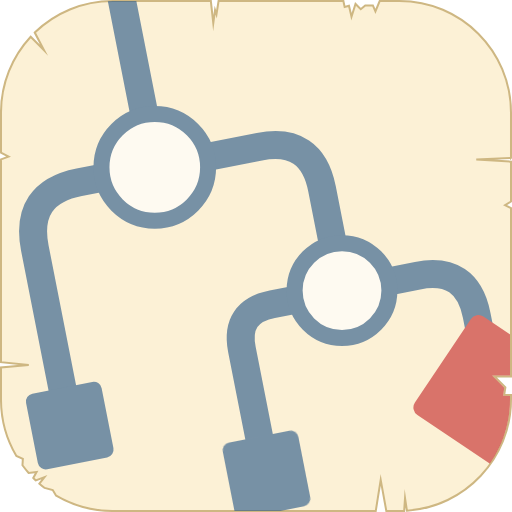

# Sidequest

A lightweight project planner for juggling several projects.

## The perfect project management system... for me. And maybe you'll like it too!

—[Tim Samoff](https://samoff.com)

Managing multiple projects shouldn't mean spending more time organizing work than actually doing it. Sidequest provides a simple way to keep projects organized, manage tasks, decide what to work on next, and make steady progress.

That's why there's Sidequest.

Sidequest is a lightweight, easy-to-use project management system. There's no complicated process to learn, no particular way you're expected to work, and no elaborate system to maintain. Just organize your projects, add some tasks, and get to work.

Learning how to use Sidequest takes about a minute. There's a quick tutorial to show you around, and then you're on your own... in a good way.

If you're already using Trello or Todoist, you can import your existing projects and tasks into Sidequest. And if you don't need anything fancy, Sidequest works just as well as a simple to-do list.

You can use Sidequest wherever you want. Run it right in your browser, or install it as a Progressive Web App (PWA) for offline access. The browser and PWA versions save your data locally, and won't sync between devices. You can also use Sidequest as a Claude Artifact or a Muse space, which saves your data to your account and makes it available across all of your devices. Claude and Muse operate independently, so choose one.

Sidequest has plenty of features to help you organize and keep track of your work, but you don't have to use all of them. Use as much or as little as you need. It's your system.

So give Sidequest a try! It's free, and it might become your favorite way to keep track of all your side quests.

*"Even the smallest step carrieth thee onward."* —Sidequest

## Getting started

Ready to give it a try? Choose where you want to use Sidequest. There's also a [feature tour and setup guides](https://samoff.com/sidequest/) if you'd like a closer look before getting started.

You can switch between versions later, but your data won't move between them automatically. To carry it over, use a backup file (see [Saving and syncing your data](#saving-and-syncing-your-data)).

- **Browser:** Use [samoff.com/sidequest/app](https://samoff.com/sidequest/app/) directly in your browser. No account needed, and your data stays in the browser on that device.
- **Installed app (PWA):** In a supported browser, open **Options** and choose **Install Sidequest**. It opens in its own window and works offline. On some phones, you'll need to use your browser's **Add to Home Screen** option instead.
- **Claude:** Build Sidequest as a Claude Artifact. See [Use as app](#use-as-app).
- **Muse:** Build Sidequest as a Muse space. See the same section.

A short tutorial shows you how to add a quest, give it a task, and get started. Choose **Play tutorial** in the Welcome panel or the **Field guide** to run it. There are also a few sample quests to explore. When you're ready to start with a clean slate, open **Options** and choose **Start fresh**.

## Features

Sidequest organizes projects into **quests**, with **tasks** and **steps** to break the work down.

### Quests

- Each quest has its own page for tasks, notes, and scheduling. New quests start as **candidates**, giving you a place to work out the details before getting started. Choose **Promote** when you're ready to begin, and **Mark complete** when the quest is finished.

### Errands

- A simple to-do list for the little things that don't need their own quest. Add a due date if you like, then check them off when they're done.

### Ideas
- Use ideas to explore possibilities before turning them into quests. Ideas live in the **Workshop**, where you can develop them and make them into **candidate quests**.

### Knowing what to work on

- **Today:** See your next task, anything overdue, and a burndown chart showing your progress.
- **Quests page:** See what you're working on and what's coming up next in each quest. You'll also find candidates waiting to get started and completed quests.

### Staying organized

- **Pinning:** Pin your current or high-priority quests for quick access.
- **Vault:** Set aside quests and ideas you no longer need at the moment. You can restore them later or permanently delete them.

## Additional features

These features are optional. Use them when they're useful, or ignore them if they're not.

- **Timeline and burndown:** See all your quests on one calendar. Track planned versus actual progress and get a forecast of when you'll finish at your current pace.
- **Milestones and launch checklist:** Mark dated tasks as milestones, or flag the tasks that need to be finished before a quest can launch.
- **Decisions:** Attach a question to any step. Answering it checks the step off.
- **Quest links:** Connect related quests.
- **Search:** Press `/` anywhere to search across Sidequest.
- **Slip schedule:** Running behind? Push all unfinished tasks in a quest to later dates in one step. You can undo the change.
- **Quest giver export:** Give a client a read-only copy of a quest, with your contact details if you want to include them.
- **Options:** Choose what to call each stretch of work (Block, Sprint, Iteration, Phase, or Week), set its length, and customize your date format, theme, and sound effects.
- **Field guide:** Find short instructions for everything, right inside the app.

## Importing existing projects

You can bring existing projects into Sidequest from Trello or Todoist. Open **Options** and choose **Import from Trello** or **Import from Todoist**.

Each import creates a new quest, so importing the same file twice creates two quests. You'll see a summary of what will be imported before anything is saved.

- **Trello:** Export your board as a JSON file from Trello, then select it in Sidequest. Cards become tasks, with descriptions carried over as notes and due dates preserved. Checklist items become steps, including their completion status. Cards without due dates go into the Backlog. Archived cards are skipped. Labels, members, comments, attachments, and custom fields aren't imported.
- **Todoist:** Export a project as a CSV file from Todoist, then select it in Sidequest. Tasks come across with their due dates and notes. Todoist doesn't include completed tasks in its exports, so those won't appear in Sidequest. Also, exports are capped at 300 tasks, so a file with exactly 300 tasks may be incomplete. Subtasks become regular tasks, and labels aren't imported. Relative dates such as "today," "tomorrow," and "in 3 days" are converted to calendar dates. Repeating tasks are imported without a schedule.

## Use as app

You can also run Sidequest as a Claude artifact or a Muse space. Both versions use the same single-file app, but save your data to your own account instead of your browser.

You'll need an account with whichever platform you choose, since both building the app and storing its data happen there. Copy the prompt for your platform below, paste it into a new chat, and let it build your copy.

The [Sidequest-App/README.md](Sidequest-App/README.md) covers updating your app, sharing it, and the differences between the artifact and browser versions.

### Claude

Start a new conversation with Claude and send this prompt. Sidequest needs the `db` capability to save your data and the `downloads` capability to make **Save backup** work.

```
Please fetch this file and publish it as an artifact: https://raw.githubusercontent.com/timsamoff/sidequest/main/Sidequest-App/sidequest.html. It needs the `db` capability for storage and the `downloads` capability so Save backup works.
```
If Claude asks for permission during the build, choose **Allow once** to let it fetch the file and create the artifact. It asks again when you update.

Open the artifact Claude creates. If you pin it, it will appear in the Claude sidebar.

If Claude can't fetch the file, download `sidequest.html` from the `Sidequest-App` folder in the repository, upload it to a new conversation, and ask Claude to publish it as an artifact with the `db` and `downloads` capabilities.

### Muse

Start a new chat with your Muse and paste this prompt. It asks Muse to build Sidequest from the repository and save your data in its database.

```
Please build the Sidequest fullstack app as a private artifact for me, and call it Sidequest, from https://raw.githubusercontent.com/timsamoff/sidequest/main/Sidequest-App/sidequest.html. Store all of the app's data (the whole JSON object it keeps in the browser localStorage key "sidequest-template-v1") in the Muse database so it persists, starting empty.

Keep every feature as is, including the sound effects and the GitHub version check, and keep its update prompt word for word. Set window.sidequestHosted = true before the app starts, so it shows its hosted wording about where your data is saved.

Keep this Google Fonts stylesheet in the <head> of the client's index.html, and make sure it survives the build into the published bundles, because the launch quotes are sized for IM Fell English and overflow their two-line box in the Georgia fallback:

<link rel="stylesheet" href="https://fonts.googleapis.com/css2?family=IM+Fell+English+SC&family=IM+Fell+English&family=Alegreya+Sans:wght@400;500;700&display=swap">

When it's built, launch the app several times to confirm every launch quote fits its two-line box, and click-test every button, dialog, and import before handing it over.
```

Muse builds the app in the background, which can take up to 20 minutes. When it's ready, Muse gives you a card to open it.

The first time you open Sidequest, Muse asks for permission to check for updates online. Choose **Always allow** so it can check automatically from then on.

If Muse can't fetch the file, attach `sidequest.html` to the chat instead and replace the link in the prompt's first sentence with "the attached sidequest.html".

## Saving and syncing your data

**Browser and installed app**

Your data is saved in your browser on the device you're using. Nothing is sent anywhere. There are a few things to keep in mind:

- Your data doesn't sync between devices or browsers.
- Clearing your browser data also clears your quests.
- Use **Save backup** in **Options** to save everything to a file. **Restore backup** loads it back in. If you haven't made a backup in two weeks, Today will remind you.

**Claude and Muse**

Your data is saved to your own account, so it's available on any device where you sign in. Claude and Muse keep separate copies of your data, and neither can access the browser version's data.

To move your quests between versions, save a backup in one and restore it in the other.

## License and credits

© [Tim Samoff](https://samoff.com). Licensed under [GPLv3](LICENSE).

[Support Sidequest](https://www.paypal.com/paypalme/timsamoff)
