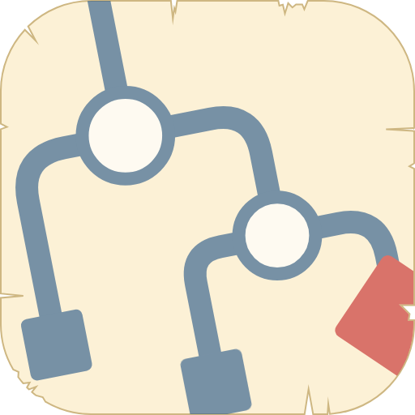

# Sidequest as an app

`sidequest.html` is a single self-contained file. Hand it to an AI app builder and you get your own copy of Sidequest that saves your data to your account instead of your browser, so it works the same across your devices. This folder covers two builders: Claude, which makes an artifact, and Muse, which makes a space.

Sidequest itself has no account. These versions do need an account with the builder you choose, because building the app and storing its data both happen there. The plain web version (`index.html`) needs no account of any kind.

The prompts in this README use this raw link to the file:

```
https://github.com/timsamoff/sidequest/releases/download/v0.99.11/sidequest.html
```

## Claude

The artifact needs two capabilities. Without `db`, nothing saves. Without `downloads`, the **Save backup** button can't give you a file.

### First-time setup

The prompt to send is in the main [README](../README.md#claude). Claude fetches the file and publishes it as an artifact.

If Claude asks for permission during the build, choose **Allow once** so it can fetch the file and create the artifact. It asks again every time you update.

Open the artifact Claude creates. That link is yours, so bookmark it or pin it. If you pin it, it appears in the Claude sidebar, and it's how you get back to your data.

If Claude can't fetch the file, download `sidequest.html` from the [latest release](https://github.com/timsamoff/sidequest/releases), upload it to a new conversation, and ask Claude to publish it as an artifact with the `db` and `downloads` capabilities.

## Muse

Muse builds Sidequest from the source file on GitHub and runs it on its own hosted runtime. Muse stores your quests, tasks, and settings in a database tied to your account, so they sync across devices and the app opens with everything in place wherever you're signed in. When you update, Muse rebuilds the app from the latest file and leaves the database as it is.

### First-time setup

The prompt to paste is in the main [README](../README.md#muse). Muse fetches the file from the repo itself and builds it in the background, which can take up to 20 minutes. When it's ready, Muse gives you a card to open it. Your data lives only in your Muse environment.

The first time you open the app, it asks for permission to check for updates online. Choose **Always allow** so the version check runs without asking again.

If Muse can't fetch the file, attach `sidequest.html` to the chat instead and replace the link in the prompt's first sentence with "the attached sidequest.html".

## Updating to a new version

When a new version is released, a banner on the **Today** page says so. It holds a prompt you can copy, and the same prompt works in both builders:

> Please update my Sidequest artifact with the latest version, keeping all of my existing data.
> https://github.com/timsamoff/sidequest/releases/download/v0.99.11/sidequest.html

1. Copy the prompt from the banner.
2. Paste it into the conversation where you built your app, or give the builder the link to your artifact.
3. If Claude asks for permission, choose **Allow once** so it can fetch the file and update the artifact.
4. Open the updated artifact. Your data lives with your account, not in the file, so an update keeps it.

The banner adds ?v= and the new version number to the end of the link, so a builder that cached an older copy of the file fetches the new one instead. If you type the prompt yourself, you can add the same suffix.

On Claude, update your **existing** artifact. Publishing the file as a brand-new artifact creates an empty database with no path back to your old data. If you do it by accident, your old artifact and its data are still there. Go back to that one.

## Sharing

By default, only you can edit your copy. If you make it public or share the link, other people can view it, but their changes won't save back to your data unless you grant them edit access.

If you do grant edit access, there is no conflict handling. If two people change the same task or quest at the same moment, whoever saves last wins, silently. That's fine for occasional use but not for two people working in it at once.

## What's different from the web version

- **Where your data lives.** The web version keeps it in your browser, on one device. These versions keep it in your Claude or Muse account.
- **No AI branding in the file.** That's on purpose, so the file stays portable. This README is the one place that explains the builder-specific setup.
- **The installable app and its **Refresh** button** are part of the web version only.
